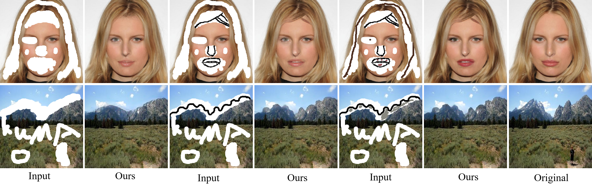

# DeFLOCNet

**Deep Image Editing via Flexible Low-Level Controls · CVPR 2021**

[Paper](https://arxiv.org/abs/2103.12723) · [Models](https://huggingface.co/KumaPower/DeFLOCNet) · [Interactive Studio](https://huggingface.co/spaces/KumaPower/DeFLOCNet-Studio) · [Architecture notes](docs/REFACTOR.md) · [Original implementation](docs/LEGACY_README.md)

Edit an image by marking a hole, drawing optional sketch lines, and adding sparse
color hints. DeFLOCNet propagates these controls through the generator to guide
the content inside the hole. With no sketch or color hints, it performs ordinary
image inpainting. Known pixels are copied from the prepared input image.

This repository includes the original DeFLOCNet implementation, a PyTorch 2
reference profile, and modern `sd_color_v2` experiments. The two downloadable
models below use `sd_color_v2`: a single-pass RGB GAN with a residual U-Net and
separate sketch/color feature paths, trained from scratch. Its SD-style building
blocks do not require diffusion sampling or pretrained Stable Diffusion weights.

## Models

| Model | Training step | Intended input | Checkpoint |
| --- | ---: | --- | --- |
| HDTF portrait | 10,000 | Face-centered portraits | [deflocnet-hdtf-step10000.pt](https://huggingface.co/KumaPower/DeFLOCNet/resolve/main/deflocnet-hdtf-step10000.pt) |
| General scenes | 23,500 | Natural scenes and other general images | [deflocnet-general-step23500.pt](https://huggingface.co/KumaPower/DeFLOCNet/resolve/main/deflocnet-general-step23500.pt) |

The portrait model was trained in a dedicated HDTF run; the general model uses
a mixed image collection that includes a small HDTF portrait component.
Both operate on **256 × 256 RGB**. These are modern
experimental checkpoints; the original paper architecture and benchmark setup
are documented separately below. See the [model card](https://huggingface.co/KumaPower/DeFLOCNet)
for checkpoint provenance and evaluation details.

Download one model for command-line inference, or both for the local comparison
Studio:

```bash
mkdir -p checkpoints
curl -fL https://huggingface.co/KumaPower/DeFLOCNet/resolve/main/deflocnet-hdtf-step10000.pt \
  -o checkpoints/deflocnet-hdtf-step10000.pt
curl -fL https://huggingface.co/KumaPower/DeFLOCNet/resolve/main/deflocnet-general-step23500.pt \
  -o checkpoints/deflocnet-general-step23500.pt
```

The public files contain inference weights. Continuing training requires a full
training checkpoint with optimizer, RNG, data cursor, config, and source state.

## Install

Use Python 3.10+ and a compatible PyTorch/torchvision installation. The package
requires PyTorch 2.6+ and torchvision 0.21+.

```bash
git clone https://github.com/KumapowerLIU/DeFLOCNet.git
cd DeFLOCNet
python -m pip install -e .
```

For the browser editor, install the demo extras:

```bash
python -m pip install -e '.[demo]'
```

Inference uses the selected generator checkpoint. Training additionally needs
local HED, VGG, and calibrated LPIPS weights; their sources and checksums are
listed in [the attribution notes](docs/REFERENCES.md).

## Interactive Studio

Open [DeFLOCNet Studio on Hugging Face](https://huggingface.co/spaces/KumaPower/DeFLOCNet-Studio),
or launch it locally with the two downloaded checkpoints:

```bash
python -m deflocnet.web_demo \
  --checkpoint-a checkpoints/deflocnet-hdtf-step10000.pt \
  --checkpoint-b checkpoints/deflocnet-general-step23500.pt \
  --label-a "HDTF portrait" --label-b "General scenes" \
  --device cuda:0
```

The local app opens at `http://127.0.0.1:7860`. Use `--device cpu` without CUDA,
or `--port` to choose another port. It binds to loopback with public sharing
disabled. Optional `--sha256-a` and `--sha256-b` verify the checkpoint files.

1. **Prepare the image.** Choose **Use full image** for a scene or an existing
   portrait crop. It resizes the RGB image to the 256 × 256 canvas used in
   training. For an uncropped portrait, choose **Auto-frame portrait** when
   available. Inspect the prepared image before drawing; the result is this canvas.
2. **Paint the hole.** White mask pixels mark the region to generate. Leave
   visible context around the edit.
3. **Add optional controls.** Sketch lines guide structure; sparse color marks
   suggest colors. You can enable either control independently or use both.
4. **Run a model or compare both.** Select **HDTF portrait**, **General scenes**,
   or **Compare both**. Comparison uses the same prepared image, mask, hints,
   and noise seed. Inspect the side-by-side results or wipe slider, then
   download the completed PNG.

### Optional portrait framing

The local app can use the OpenCV YuNet face detector to produce a square,
face-centered crop. Install the demo extras, download the detector, and add
`--face-detector weights/face_detection_yunet_2023mar.onnx` to the launch command:

```bash
mkdir -p weights
curl -fL https://media.githubusercontent.com/media/opencv/opencv_zoo/main/models/face_detection_yunet/face_detection_yunet_2023mar.onnx \
  -o weights/face_detection_yunet_2023mar.onnx
```

Use a photo with one clearly visible face. The app checks the detector file's
checksum and shows the crop before editing. This is an axis-aligned crop that
approximates HDTF framing; [HDTF's original crop windows](https://github.com/MRzzm/HDTF#processing-of-hdtf-dataset)
are defined per video clip. General-image editing does not require face detection.

The optional `--face-config` flag is for a locally available HDTF validation
manifest and RTV cache. It adds fixed validation samples and optional reference
guides to the editor. Uploaded images need no ground-truth guides or dataset.

## Command-line inference

Prepare aligned **256 × 256** inputs. The image and all control maps must refer
to the same crop and pixel coordinates. The CLI uses these supplied inputs
directly; use the Studio to prepare a portrait crop interactively.

```bash
python -m deflocnet.infer \
  --checkpoint checkpoints/deflocnet-general-step23500.pt \
  --image input.png --mask hole.png \
  --output results/example --device cuda:0 --seed 2019
```

For portraits, substitute `checkpoints/deflocnet-hdtf-step10000.pt`. Use
`--device cpu` to run on CPU. `--output` is a directory containing
`completed.png`, the uncomposited `raw.png`, and `inference.json` metadata.

| Input | Convention |
| --- | --- |
| `--image` | RGB image providing the visible context |
| `--mask` | White = hole to generate; black = known image |
| `--sketch` | Optional white sketch lines on a black background |
| `--color` | Optional RGB color hints |
| `--color-mask` | White = supplied color hint; black = absent hint |

Supply `--color` and `--color-mask` together. The separate validity mask allows
black and gray to be real hints. Controls are applied inside the editing hole.
For an edit with both types of guidance:

```bash
python -m deflocnet.infer \
  --checkpoint checkpoints/deflocnet-general-step23500.pt \
  --image input.png --mask hole.png --sketch sketch.png \
  --color color.png --color-mask color-mask.png \
  --output results/guided --device cuda:0 --seed 2019
```

## Train on your data

The JSON files in [configs/](configs/) are editable training templates:

| Recipe | Config |
| --- | --- |
| HDTF portrait, 10,000-step schedule | [sd-color-v2-hdtf.json](configs/sd-color-v2-hdtf.json) |
| General scenes, boundary-loss recipe | [sd-color-v2-boundary.json](configs/sd-color-v2-boundary.json) |

Prepare separate training and validation JSONL manifests, local weight files,
and an RTV cache location; update the corresponding paths and SHA256 fields
before running. Training reads existing images and verifies the supplied hashes.
It does not download an image dataset.

A manifest can list ordinary image files, one absolute path per JSON record:

```json
{"format": "image", "path": "/absolute/path/to/image.jpg"}
```

Indexed TAR and TFRecord records are also supported. For video-derived portrait
frames, separate source videos when constructing training and validation sets.
Copy the selected template to your own config and edit its data and weight
locations:

```bash
cp configs/sd-color-v2-boundary.json configs/my-data.json
# Edit configs/my-data.json before training.
python -m deflocnet.train --config configs/my-data.json \
  --output runs/my-data --device cuda:0
```

Both released runs used effective batch 128, microbatch 32, BF16, activation
checkpointing, and Adam at `2e-4`. Adjust the microbatch to available GPU memory;
the effective batch must be divisible by it. Random rectangles, strokes, and
their unions cover 10%–40% of the training image.

Training samples four control modes: no controls, sketch only, color only,
and both. Sketch supervision uses versioned HED postprocessing with thin
2–3px strokes; color supervision uses sparse RTV-derived hints. These training
guides are derived from the target image. At inference, you supply your own
optional hints.

| Released models' training objective | Weight |
| --- | ---: |
| Hole-normalized RGB L1 | 0.1 |
| Calibrated LPIPS-VGG v0.1 | 1.0 |
| Hinge GAN with global/local Patch discriminators | 0.1 |
| Paper hole TV | 0.1 |
| Boundary-gradient reconstruction | 0.1 |
| Low-frequency reconstruction | 0 |

LPIPS and GAN operate on completed RGB. Independent VGG perceptual and style
terms are disabled in these profiles. LPIPS stays frozen while allowing
gradients to the generated image. See [control architecture](docs/SD_CONTROLS.md)
and [completion-consistency losses](docs/COMPLETION_CONSISTENCY.md) for the
precise reductions and earlier experimental variants.

To continue a training run, use its saved config and full checkpoint:

```bash
python -m deflocnet.train --config runs/my-data/config.json \
  --output runs/my-data --resume runs/my-data/latest.pt --device cuda:0
```

Resume checks source/config compatibility and restores optimizer state, RNG,
and the data cursor. Checkpoint retention is controlled by `keep_checkpoints`;
`latest.pt` points to the newest saved training state. Fixed evaluation previews
are generated separately. Use a new run for a new data or architecture profile.

For fixed validation previews from a full training checkpoint and its local
validation data:

```bash
python -m deflocnet.evaluate --checkpoint runs/my-data/latest.pt \
  --output evaluations/my-data
```

Guided and no-control results are reported separately. Reference HED/RTV guides
derived from the target contain information inside the hole, so guided metrics
must be interpreted with that input condition.

## Original paper and implementation

The [CVPR 2021 method](https://arxiv.org/abs/2103.12723) injects sketch and color controls into structure generation
blocks and combines structure and texture decoder features. The retained
`released_v1` profile uses the original encoder, 21 SGB cells across six scales,
and dual decoders. Its implementation and paper/code differences are described
in the [correctness audit](docs/REFACTOR.md).

```text
Masked RGB + valid mask + noise → encoder → texture decoder
                                    ↓            ↓ additions
Sketch + sparse color + noise → six-scale SGBs → structure decoder → completed RGB
```



*Original project examples. The downloadable modern checkpoints use the
separate `sd_color_v2` architecture and training recipes described above.*

The original Qt demo, weight filenames, and legacy workflow are preserved in
[the original README](docs/LEGACY_README.md). Modern and original checkpoint
formats require their matching implementations.

## Data, testing, and citation

Datasets, private manifests, and held-out HDTF previews are not bundled. Obtain images from
their providers and follow their terms: [HDTF](https://github.com/MRzzm/HDTF),
[Places2](http://places2.csail.mit.edu/),
[CelebA](https://mmlab.ie.cuhk.edu.hk/projects/CelebA.html), and
[Unsplash](https://unsplash.com/). The exact mixed collection is not offered as
a public dataset download.

Run the software checks locally:

```bash
python -m pip install -e '.[test]'
pytest -q
```

```bibtex
@inproceedings{liu2021deflocnet,
  title={DeFLOCNet: Deep Image Editing via Flexible Low-Level Controls},
  author={Liu, Hongyu and Wan, Ziyu and Huang, Wei and Song, Yibing and Han, Xintong and Liao, Jing and Jiang, Bing and Liu, Wei},
  booktitle={CVPR},
  year={2021}
}
```

See [LICENSE](LICENSE) and the component-specific notices in
[docs/REFERENCES.md](docs/REFERENCES.md), including the HED implementation's
upstream license.
