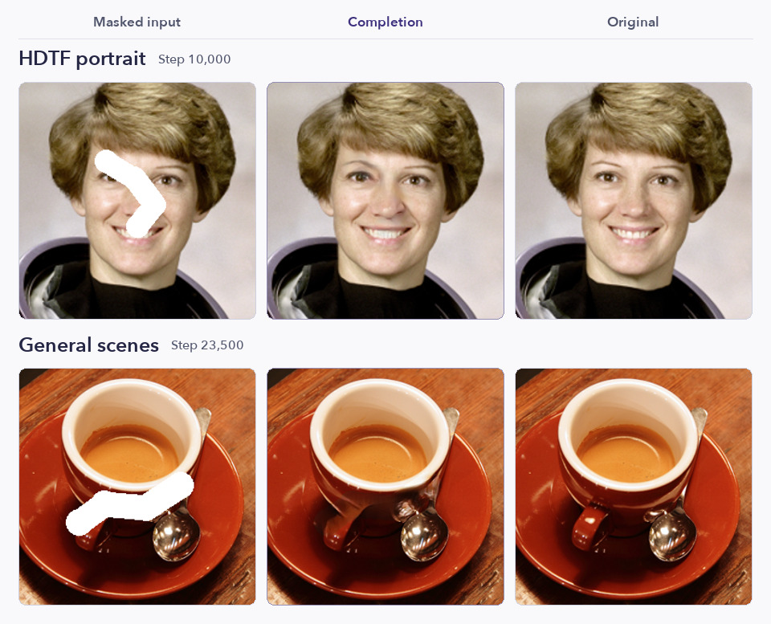
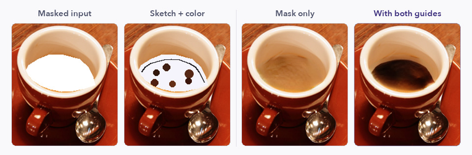
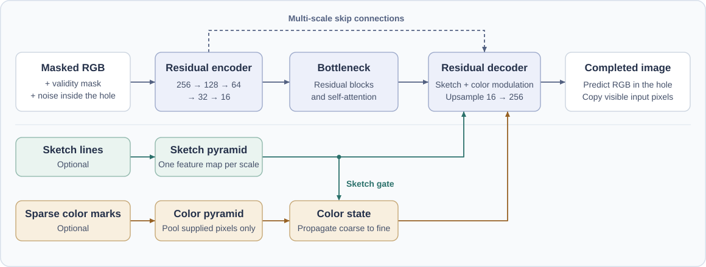

<div align="center">

<p><strong>CVPR 2021 · Modern PyTorch implementation</strong></p>

<h1>DeFLOCNet</h1>

<p><strong>Deep Image Editing via Flexible Low-Level Controls</strong></p>
<p>Hongyu Liu · Ziyu Wan · Wei Huang · Yibing Song · Xintong Han · Jing Liao · Bing Jiang · Wei Liu</p>

<p>
  <a href="https://openaccess.thecvf.com/content/CVPR2021/html/Liu_DeFLOCNet_Deep_Image_Editing_via_Flexible_Low-Level_Controls_CVPR_2021_paper.html">Paper</a> ·
  <a href="https://huggingface.co/spaces/KumaPower/DeFLOCNet-Studio"><strong>Live demo</strong></a> ·
  <a href="#checkpoints">Checkpoints</a> ·
  <a href="#quick-start">Quick start</a> ·
  <a href="#architecture">Architecture</a> ·
  <a href="#training">Training</a> ·
  <a href="https://github.com/KumapowerLIU/DeFLOCNet/tree/legacy">Original code</a>
</p>



<p><sub>Selected outputs from the two released checkpoints. White marks the hole. Neither example uses sketch or color guides. <a href="https://huggingface.co/spaces/KumaPower/DeFLOCNet-Studio/blob/main/ASSETS.md">Image credits</a></sub></p>

</div>

DeFLOCNet fills masked regions and lets you guide the edit with optional sketch
lines and sparse color marks. The modern release includes a dedicated portrait
checkpoint and a general-image checkpoint. Both work at **256 × 256 RGB** and
copy the visible pixels from the prepared input.

## Interactive Studio

[**Open DeFLOCNet Studio on Hugging Face**](https://huggingface.co/spaces/KumaPower/DeFLOCNet-Studio)

1. Upload an image or choose a thumbnail under **Try a sample**. Use
   **Auto-frame portrait** for uncropped faces or **Use full image** for scenes.
2. Paint the hole in **white**. Add a sketch to describe the shape or sparse
   color marks inside the hole. Either hint is optional.
3. Run one checkpoint or select **Compare both** to use the same image, mask,
   hints, and seed for both. View the results side by side or with the wipe
   slider and download a PNG.

The [local Studio guide](docs/INFERENCE.md#interactive-studio) covers launch
options, optional face detection, and the command-line control formats.

<p align="center">
  
</p>

*One edit shown with and without guides. Both outputs use the same crop, mask,
seed, and general checkpoint. The black arc and brown dots are the supplied
sketch and color hints.*

## Checkpoints

| Model | Step | Training data and intended input | Download |
| --- | ---: | --- | --- |
| **HDTF Portrait** | 10,000 | Dedicated HDTF run for face-centered portraits | [Portrait weights](https://huggingface.co/KumaPower/DeFLOCNet/resolve/main/deflocnet-hdtf-step10000.pt) |
| **General Scenes** | 23,500 | Mixed images, including a small HDTF component, for scenes and everyday images | [General weights](https://huggingface.co/KumaPower/DeFLOCNet/resolve/main/deflocnet-general-step23500.pt) |

Each download is a generator-only inference bundle of about **323 MiB**. The
[model card](https://huggingface.co/KumaPower/DeFLOCNet) gives provenance and
checksums.

## Quick start

Use Python **3.10+**, PyTorch **2.6+**, and torchvision **0.21+**.

```bash
git clone https://github.com/KumapowerLIU/DeFLOCNet.git
cd DeFLOCNet
python -m pip install -e .

mkdir -p checkpoints
curl -fL https://huggingface.co/KumaPower/DeFLOCNet/resolve/main/deflocnet-general-step23500.pt \
  -o checkpoints/deflocnet-general-step23500.pt

python -m deflocnet.infer \
  --checkpoint checkpoints/deflocnet-general-step23500.pt \
  --image input.png --mask hole.png \
  --output results/example --device cpu --seed 2019
```

Supply a 256 × 256 RGB image and an aligned binary mask with a white hole on a
black background. The command writes `results/example/completed.png` and
inference metadata. Use `--device cuda:0` for GPU inference. For portraits,
download the portrait checkpoint from the table and pass its path to
`--checkpoint`.

For the local browser editor, run `python -m pip install -e '.[demo]'` and
follow the [Studio launch instructions](docs/INFERENCE.md#interactive-studio).
For sketch and color files, see the [CLI input conventions](docs/INFERENCE.md#command-line-inference).

## Architecture

<p align="center">
  
</p>

The released `sd_color_v2` generator edits RGB in a single forward pass.
Sketch features condition decoder blocks at every scale and gate the color state
as it propagates from coarse to fine. Each color cell pools only pixels with a
supplied hint. The output uses the predicted RGB inside the hole and the input
RGB everywhere else. See the [architecture notes](docs/SD_CONTROLS.md) for
feature shapes and modulation.

## Training

| Setting | Released recipe |
| --- | --- |
| Config | [HDTF portrait](configs/sd-color-v2-hdtf.json) · [General scenes](configs/sd-color-v2-boundary.json) |
| Batch and precision | Effective batch **128**, microbatch **32**, BF16, activation checkpointing |
| Optimizer | Adam, learning rate **2 × 10⁻⁴** |
| Random masks | Rectangles, strokes, and their unions with **10–40%** missing area |
| Losses | **1.0** LPIPS + **0.1** each for hole L1, hinge GAN, hole TV, and boundary gradients |

The [training guide](docs/TRAINING.md) covers data manifests, HED and LPIPS
weights, launch and resume commands, and validation. Get images from
[HDTF](https://github.com/MRzzm/HDTF), [Places2](http://places2.csail.mit.edu/),
[CelebA](https://mmlab.ie.cuhk.edu.hk/projects/CelebA.html), and
[Unsplash](https://unsplash.com/) under their respective terms.
[Dataset preparation and sources](docs/TRAINING.md#dataset-sources).

## Original release and citation

The [`legacy` branch](https://github.com/KumapowerLIU/DeFLOCNet/tree/legacy)
contains the original CVPR 2021 code, Qt demo, and original checkpoint
instructions. The [reference-profile audit](docs/REFACTOR.md) describes the
PyTorch 2 port of the paper architecture.

```bibtex
@inproceedings{liu2021deflocnet,
  title={DeFLOCNet: Deep Image Editing via Flexible Low-Level Controls},
  author={Liu, Hongyu and Wan, Ziyu and Huang, Wei and Song, Yibing and Han, Xintong and Liao, Jing and Jiang, Bing and Liu, Wei},
  booktitle={CVPR},
  year={2021}
}
```

[License](LICENSE) · [Component attribution](docs/REFERENCES.md) · [Software checks](docs/TRAINING.md#software-checks)
